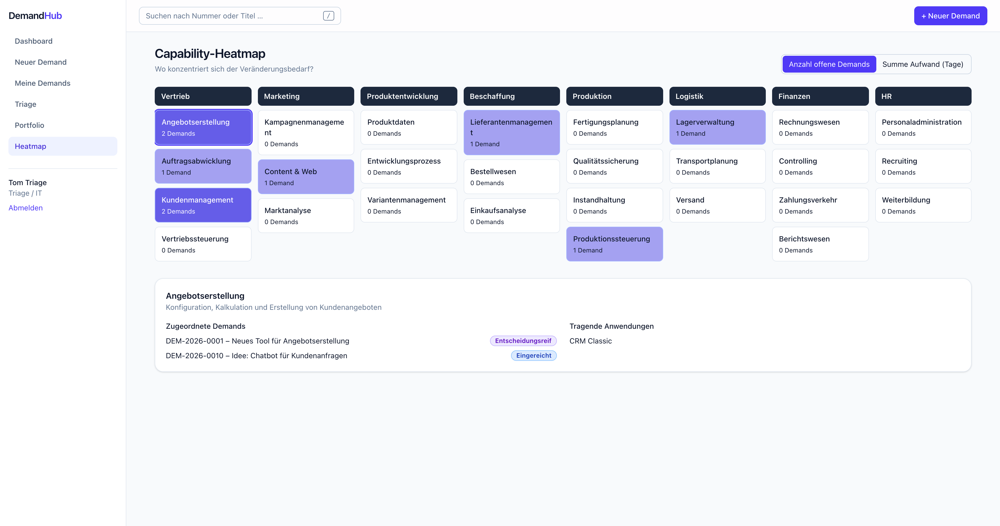
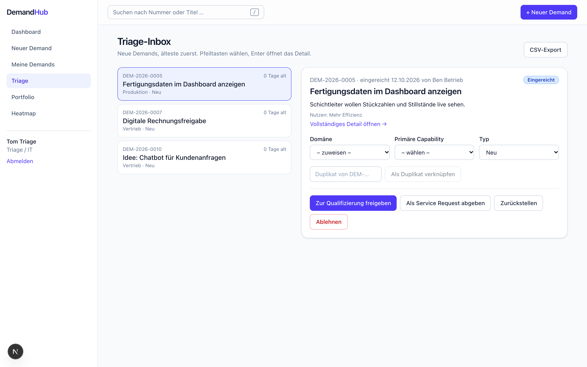
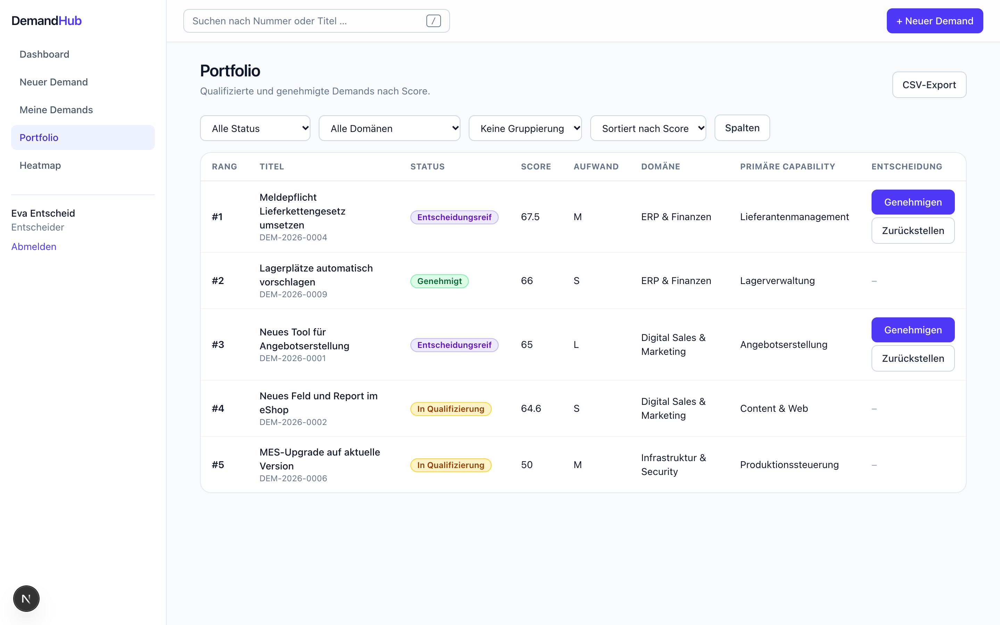
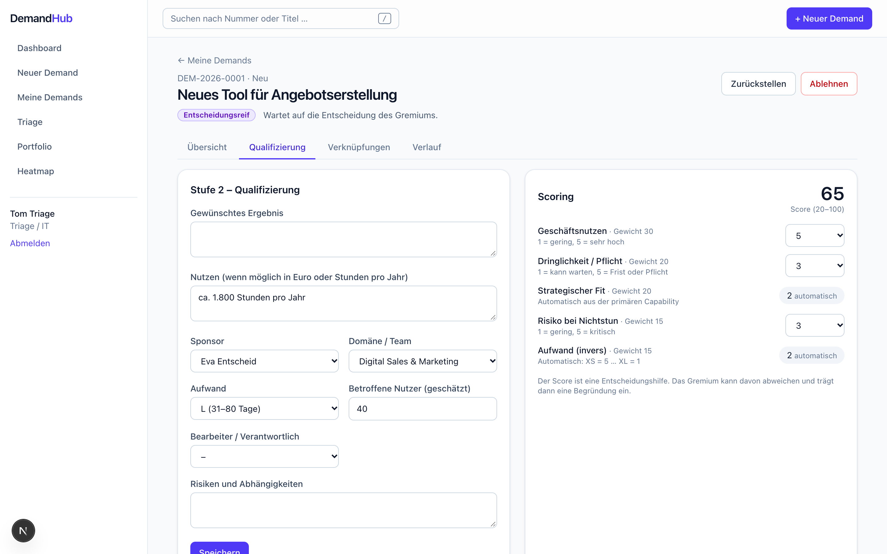

# DemandHub – IT-Demand-Management (Click-Dummy)

Next.js (App Router, TypeScript, Tailwind) als Oberfläche, PocketBase als lokales Backend.
Alles läuft lokal, ohne Cloud, E-Mail oder Anbindung an andere Systeme.

## Screenshots

**Business Capability Map (Heatmap)** – L1-Capabilities als Spalten, L2 als Kacheln, eingefärbt nach Anzahl offener Demands (umschaltbar auf Summe Aufwand). Ein Klick zeigt zugeordnete Demands und tragende Anwendungen.

**Triage-Inbox** – neue Demands nach Alter, Schnellaktionen im Seitenpanel (Domäne, Capability, Typ, Duplikat, freigeben, zurückstellen, ablehnen).

**Portfolio** – qualifizierte Demands mit Score und Rang; Entscheider genehmigen oder stellen direkt aus der Zeile zurück.

**Demand-Detail, Qualifizierung und Scoring** – Stufe-2-Felder und gewichtetes Scoring (20–100).

## Start

1. [PocketBase](https://pocketbase.io/docs/) herunterladen und die Programmdatei `pocketbase` ins Projektverzeichnis legen.
2. Abhängigkeiten installieren: `npm install`
3. Einmalig einen PocketBase-Superuser anlegen:
   `./pocketbase superuser upsert admin@demand.local demandadmin123`
4. In Terminal 1: `npm run pb` (PocketBase auf Port 8090, Admin-Oberfläche unter http://127.0.0.1:8090/_/)
5. In Terminal 2: `npm run seed` (legt Collections, API Rules und Demo-Daten an) und danach `npm run dev`
6. http://localhost:3000 öffnen.

Zurücksetzen: PocketBase stoppen, Ordner `pb_data` löschen, Schritte 3–5 wiederholen.

## Demo-Benutzer (Passwort für alle: `demo1234`)

| Benutzer | Rolle |
|---|---|
| anna, ben | Antragsteller |
| tom | Triage / IT |
| eva | Entscheider |
| admin | Admin |

Auf der Login-Seite gibt es eine Schnellauswahl.

## Drei Kernabläufe

1. **anna** erfasst unter „Neuer Demand“ einen Demand und sieht ihn unter „Meine Demands“.
2. **tom** weist in der Triage Domäne und primäre Capability zu, gibt zur Qualifizierung frei, ergänzt Stufe 2 und Scoring im Detail und meldet „Entscheidungsreif“.
3. **eva** lehnt im Portfolio einen Demand mit Begründung ab oder genehmigt ihn; **anna** sieht die Begründung im Detail.

## Aufbau

- `scripts/seed.mjs` – Collections, API Rules, Seed-Daten
- `lib/workflow.ts` – Statusmaschine, Voraussetzungen, Scoring, StatusHistory
- `lib/de.ts` – alle Texte der Fachlogik (Grundlage für spätere Übersetzung)
- `app/(app)/…` – Dashboard, Demands, Triage, Portfolio, Heatmap, Admin

## Bekannte Grenzen des Click-Dummys

- Statusregeln laufen im Frontend; die API Rules verhindern aber, dass Antragsteller Status, Score, Domäne oder Entscheidung selbst setzen. Später als PocketBase-Hook.
- Der Entwurf des Erfassungsformulars wird im Browser (localStorage) gesichert.
- Capability-Baum im Admin wird per Eltern-Auswahl gepflegt, noch ohne Drag-and-drop.
- @-Erwähnungen werden hervorgehoben, aber noch nicht vorgeschlagen oder benachrichtigt.
- Keine Anhänge, E-Mails, vertraulichen Demands, automatisierten Tests.
